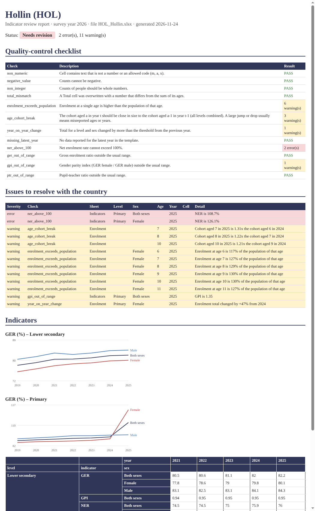

# Education Template Pipeline

Python tools that automate the whole life cycle of **multi-year Excel data-entry templates** for education statistics, the kind national statistics offices fill in for international surveys:

1. **Build** a template with built-in data validation, Total formulas and an Indicators sheet
2. **Update** filled templates to add a new year of data entry, carrying all formulas forward
3. **Pre-fill** known values (e.g. population projections) without overwriting country data
4. **Translate** templates into French, Spanish, Portuguese and Russian
5. **Validate** every submission against configurable rules, including **age-cohort checks**
6. **Calculate** indicators (GER, NER, GPI, pupil-teacher ratio)
7. **Consolidate** all countries into one database, with a QC log and a review report per country
8. **Upload and check** templates in a small Streamlit app, for non-programmers

> All data in this repository is **synthetic**: the countries are fictional and the numbers are generated. No real country data is used.

## Quick start

```bash
pip install -r requirements.txt

python -m edu_pipeline generate  --out data                      # blank template + 8 synthetic country submissions
python -m edu_pipeline process   --src data/submissions --out outputs
python -m edu_pipeline add-year  --src data/submissions --dst data/updated_2026 --year 2026 \
                                 --prefill data/population_projection_2026.csv
python -m edu_pipeline translate --template data/template_blank.xlsx --out data/translated

streamlit run app.py                                              # optional web app
pytest -q                                                         # 14 tests
```

Example output of `process`:

```
Read 8 submission(s), 5,488 cells; 0 unreadable file(s).
  ARL Arlandia   Accepted                0 errors   0 warnings
  BOR Borvania   Needs revision          2 errors   5 warnings
  CAL Calmara    Needs revision          1 errors   0 warnings
  DEL Deltaria   Accepted with queries   0 errors   5 warnings
  EST Estoria    Accepted with queries   0 errors   2 warnings
  FEN Fenwick    Accepted with queries   0 errors   1 warnings
  GLE Glenmora   Accepted                0 errors   0 warnings
  HOL Hollin     Needs revision          2 errors  11 warnings
```

Six of the synthetic submissions contain deliberate, realistic errors (a negative count, text typed in a number cell, a Total typed over its formula, pupils reported at the wrong age, a missing year, a tripled teacher count, girls double-counted). The tests check that each one is caught and that the two clean submissions pass.

## Outputs



| File | What it is |
|---|---|
| `outputs/qc_log.xlsx` | **Summary** (status per country), **QC checklist** (country × check, pass/fail), **Issues** (every problem with sheet, cell, year and explanation), **Rules** |
| `outputs/reports/<ISO>.html` | Country indicator review report: checklist, issues to raise with the country, GER charts, indicator table. `index.html` links them all |
| `outputs/database.sqlite` | Tables `submissions`, `data`, `indicators`, `qc_issues` |
| `outputs/consolidated_data.csv` | Every reported cell from every country in long format, with its status (value, blank, missing, formula, non-numeric) |
| `outputs/indicators.csv` | Calculated indicators for all countries and years |
| `outputs/*.dta` | Stata versions of the consolidated data and indicators |

## The template

| Sheet | Content |
|---|---|
| Info | Country, ISO code, survey year, contact |
| Population | Population by single age (4–18) and sex, one column per year |
| Enrolment | Enrolment by level, sex and single age, with a **Total** row per block (`=SUM` formula) |
| Teachers | Teachers by level and sex |
| Indicators | GER by level and sex as **Excel formulas** (`SUMIFS`), so countries see their indicators as they type |
| Metadata | Source and footnotes per sheet and year |

Input cells use an Excel **data-validation rule** that accepts only whole numbers ≥ 0 or the codes `m` (missing), `a` (not applicable) and `x` (included elsewhere). Input cells are yellow, formula cells grey.

The GER formulas in the Excel template and the Python calculation in `indicators.py` were checked against each other after recalculating in LibreOffice: they give identical results.

## Validation rules

All thresholds and severities are in [`rules.yaml`](rules.yaml), so the methodology can change without touching the code.

| Check | Severity | What it catches |
|---|---|---|
| `non_numeric` | error | Text such as `"12,500 approx"` in a number cell |
| `negative_value` | error | Negative counts |
| `non_integer` | warning | Fractional counts of people |
| `total_mismatch` | error | A Total typed over its formula that no longer equals the sum of ages |
| `enrolment_exceeds_population` | warning | Age-specific enrolment rate above 105% |
| `age_cohort_break` | warning | The cohort aged *a* in year *t* compared with the cohort aged *a−1* in year *t−1*; large jumps reveal age misreporting |
| `year_on_year_change` | warning | Level totals changing by more than 25% in a year |
| `missing_latest_year` | warning | Blank or `m` cells in the latest year |
| `ner_above_100` | error | Net enrolment rate above 100% |
| `ger_out_of_range`, `gpi_out_of_range`, `ptr_out_of_range` | warning | Implausible indicator values |

Indicators are **not calculated when an input is missing**, rather than treating blanks as zero.

## How updating works

`add-year` opens each country's own workbook, adds the next year's column on every sheet, and creates that column's formulas by **shifting the previous year's formulas** with openpyxl's `Translator`. Any formula in the template is carried forward correctly, not only the ones this project wrote. Data validation is extended to the new column, existing values are untouched, and the command refuses to skip a year. `--prefill` then writes known values (here, synthetic population projections) only into cells that are still empty.

## How translation works

Display text (titles, notes, row and column labels) is translated from [`labels.yaml`](labels.yaml). Sheet names stay in English because they are machine keys used by formulas and scripts. Level and sex labels are translated identically on every sheet, so the Indicators formulas keep working. The reader maps translated labels back to English, so **a French or Russian submission goes through exactly the same validation**.

## Project structure

```
edu_pipeline/
  config.py       template layout, levels, official ages, missing-value codes
  template.py     builds the Excel template (styles, validation, formulas)
  synthetic.py    generates fictional country submissions with realistic errors
  update.py       adds a year and pre-fills values
  translate.py    FR / ES / PT / RU versions; maps labels back to English
  reader.py       reads any template into a tidy long table
  indicators.py   GER, NER, GPI, PTR
  validate.py     validation checks driven by rules.yaml
  outputs.py      QC log, SQLite database, HTML country reports
  pipeline.py     runs everything for a folder of submissions
  cli.py          command-line interface
app.py            Streamlit upload-and-check app
rules.yaml        validation thresholds and severities
labels.yaml       translations
tests/            pytest suite
```

## Possible extensions

- More indicators (out-of-school rate, completion rate, percentage of trained teachers)
- Comparing a new submission against the previous year's published database
- Protecting formula cells and locking the sheet structure

## Licence

MIT
